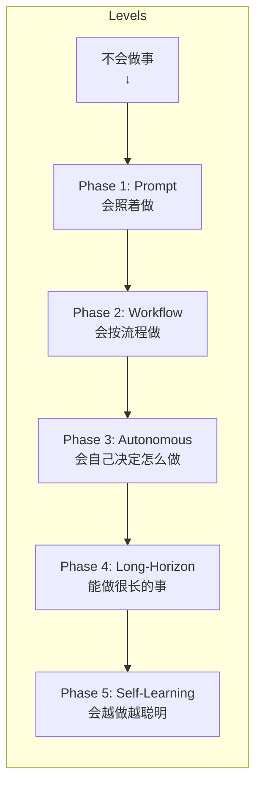

# AE-001：Agent Capability Maturity Model — 从 Prompt 到 Self-Learning 的五个跃迁

> **English summary:** The Agent Capability Maturity Model describes five
> capability levels (Prompt → Workflow → Autonomous → Long-Horizon →
> Self-Learning) that an AI agent passes through as it becomes more
> autonomous, persistent, and self-improving. Each level solves a limitation
> of the previous one rather than simply adding a feature.

## 一句话回答 / One-paragraph answer

**Agent Capability Maturity Model（智能体能力成熟度模型）** 描述了 Agent 从"回答
简单问题"到"持续自我进化"的五次能力跃迁。它并非官方标准，而是硅谷 Agent 圈近一年
总结出的一种观察框架，用来回答一个核心问题：**Agent 越来越"像人"的过程中，能力
是如何一步一步长出来的？** 每一阶段不是在已有功能上做加法，而是解决了上一阶段
遗留的根本性局限——从"只会照着做"到"会按流程做"，再到"会自己决定怎么做"，
再到"能做很长的事"，最终"会越做越聪明"。

## 为什么重要 / Why it matters

理解这个模型有助于：

- **定位当前能力水平：** 团队能准确评估自己的 Agent 处于哪个成熟度，避免在产品
  需要稳定执行时堆砌自主性、或在需要灵活性时僵化写死流程。
- **识别下一阶段瓶颈：** 每一阶段的跃迁瓶颈完全不同——第一阶段靠 Prompt Engineering，
  第二阶段靠流程编排，第三阶段靠 Planning 与 ReAct 循环，第四阶段靠 Memory 和
  Checkpoint 等系统工程，第五阶段靠经验沉淀与反馈闭环。
- **判断行业趋势：** 此框架解释了"为什么硅谷在谈 Self-Learning、国内聚焦
  Autonomous"——不是技术水平高低，而是产业成熟度不同阶段关注不同瓶颈。

## 跃迁模型 / Capability model

### 总体图景

如果把 Agent 比作一个刚出生的小孩，它的成长就是不断获得五种能力：



**注意：** 每一阶段都不是增加一个功能，而是解决上一阶段解决不了的问题。

---

### Phase 1: Prompt Wrapper（封装提示词）

| 维度 | 描述 |
| --- | --- |
| 时期 | 2023 年 |
| 核心能力 | Prompt Engineering |
| 经典形态 | AI PPT、AI 简历、AI 周报、AI 邮件等单次对话式 SaaS |
| 工作方式 | 用户 → Prompt → LLM → 答案 |
| 典型工具 | GPT API、Claude API、各类 AI 写作工具 |
| 最大局限 | 无法执行多步骤或跨工具复杂任务 |

**基本模式：**

```text
用户：帮我翻译 / 帮我总结 / 帮我润色 / 帮我写代码
模型：<直接输出结果>
```

这一阶段本质是 "LLM 已经足够聪明，很多需求只需要一句 Prompt"。其能力全部来自
模型本身，没有任何编排或工具调用。

---

### Phase 2: Workflow（固定流程）

| 维度 | 描述 |
| --- | --- |
| 时期 | 2024 年至今 |
| 核心能力 | 流程编排、状态管理 |
| 经典形态 | LangGraph、Dify Workflow、Coze Workflow、N8N、Make、Zapier AI |
| 工作方式 | 代码/配置预设步骤 → 按顺序执行 → LLM 只是其中一个节点 |
| 核心发现 | 真正复杂任务不是靠模型，而是靠流程 |
| 最大局限 | 路线写死，无法动态决策 |

**典型流程：**

```text
收到简历 → 解析PDF → 抽取信息 → 岗位匹配 → 联网搜索 → 生成建议 → 评分 → 导出PDF
```

Workflow 的优势在于 **稳定、可预测、容易 Debug**，企业非常喜欢。但它像一个流水线
而不是员工——当用户说"帮我规划一次东京自由行"时，Workflow 不知道先查天气还是先定
预算，因为所有路线都是代码写死的。

---

### Phase 3: Autonomous Agent（自主规划）

| 维度 | 描述 |
| --- | --- |
| 时期 | 2025-2026（当前最热门） |
| 核心能力 | Planning、ReAct（Reason → Act → Observe）循环 |
| 经典形态 | OpenAI Agents SDK、LangGraph、Claude Code、Codex、Cursor |
| 工作方式 | 模型自己思考：先做什么、用什么工具、何时结束 |
| 本质变化 | **以前程序员写流程，现在 LLM 写流程** |
| 最大局限 | Agent 很快就会忘记上下文（Token 长度限制） |

**核心循环：**

```text
Reason → Act → Observe → Think → Act → Observe → ...
```

这个阶段模型开始拥有 **决策权**。同样的"市场分析"任务：

- Workflow：固定搜索 → 总结 → 结束
- Autonomous：模型自己决定需要先搜哪些、几个来源、是否要 Excel/
  Python/联网、何时结束

这是目前整个行业大量投入的方向。

---

### Phase 4: Long-Horizon Agent（长时执行）

| 维度 | 描述 |
| --- | --- |
| 时期 | 现在，硅谷讨论最多的话题之一 |
| 核心能力 | Memory、Checkpoint、Resume、Task Queue、Sub Agent、Context Compression、Reflection |
| 经典形态 | Claude Code、Codex、Cursor（持续数小时乃至数天的重构任务） |
| 工作方式 | 读代码 → 分析 → 修改 → 测试 → 失败 → 继续修改 → 继续测试 → 提交 PR → Review → 继续改（可能上千次循环） |
| 最大难点 | 不是模型，而是工程 |
| 最大局限 | Agent 每次都重新学，没有持续成长 |

**为什么比 Autonomous 更难：**

一个 Autonomous Agent 可能在几十步内完成任务。而 Long-Horizon Agent 需要支持：

- 在数千步的执行过程中保持上下文
- 在失败后从中断点恢复
- 跨多次模型调用记住之前的决策和发现
- 管理子任务和子 Agent
- 压缩历史以控制 Token 使用

> Claude Code 可以连续工作 3 小时，记住之前改了哪些文件、哪些 Bug、哪些失败，
> 然后继续做——这就是 Long-Horizon 的工程体现。

---

### Phase 5: Self-Learning Agent（持续学习）

| 维度 | 描述 |
| --- | --- |
| 时期 | 前沿方向（Anthropic、OpenAI、Google DeepMind 关注） |
| 核心能力 | 从经验中总结策略、记录工具偏好、自动优化 Prompt、沉淀可复用 Workflow、建立长期 Memory、根据反馈调整行为 |
| 经典形态 | 尚在探索阶段 |
| 工作方式 | 每次执行后分析表现，改进下一次策略 |
| 注意 | 这里的"学习"不是重新训练大模型，而是更广义的能力积累 |
| 最大局限 | 仍处于早期研究阶段 |

**学习示例：**

```text
Day 1: Agent 帮用户写简历 → HR 给了 60 分
Day 2: Agent 分析为什么只有 60 分
Day 3: 再帮别人写简历 → 主动采用之前验证过的方法
```

**已有人开始讨论的 Phase 6：Self-Evolving Agent**

不仅能学习，还能自我修改——发现 Planner 太慢就自己换 Planner、测试、效果更好、
永久保留；自己写新的 Tool、生成新的 Prompt、创建新的 Workflow。这已接近真正的
软件工程智能体。

---

### 跃迁总结 / Summary

| 阶段 | 新获得的能力 | 核心问题 | 瓶颈 |
| --- | --- | --- | --- |
| Prompt | 能回答 | "你告诉我做什么" | 无法做复杂事 |
| Workflow | 能执行流程 | "我能按固定步骤完成" | 路线写死，无法应对不确定性 |
| Autonomous | 能规划 | "我自己决定怎么做" | 容易遗忘，无法长时运行 |
| Long-Horizon | 能长期执行 | "我不会因为任务太长而中断" | 每次重新学，没有成长 |
| Self-Learning | 能持续成长 | "下一次我会做得更好" | 尚在早期，工程实践不成熟 |

## 行业观察 / Industry observation

> **「硅谷在聊 Self-Learning，国内聚焦 Autonomous」**
> 
> 这不是技术水平简单高低，而是由产业成熟度决定的：
> 
> - **国内：** 大量企业还在解决"把 Agent 做出来、做稳定、做可交付"。重点放在
>   规划、工具使用、多 Agent 协作等 Autonomous 能力上。
> - **硅谷：** 不少团队已经跨过了"能完成任务"这一关，开始思考"如何让 Agent
>   越用越强"。当 Agent 要长期参与软件开发、科研、企业运营时，每次都从零开始
>   思考的成本太高，持续积累经验就成为新的竞争力。
> 
> 与其说两边在研究不同方向，不如说是在不同成熟度阶段关注不同瓶颈。

## 与 Runtime 知识卡的连接 / Connection to AR-001

[AR-001 Agent Runtime 边界](../agent-runtime/AR-001-agent-loop-and-runtime-boundaries.md)
定义了 Agent 的执行与治理层——它回答的是"Agent 在哪个容器里运行"。

本卡回答的是**Agent 的成长路径**——它从哪里开始，会发展到什么方向。

两者互补：

- Phase 1-2 基本不需要 Runtime（Prompt 几乎不需要治理，Workflow 的编排逻辑在代码中）
- Phase 3 开始需要 Runtime 来处理循环、策略、终止等
- Phase 4 对 Runtime 要求最高：状态持久化、Checkpoint、恢复
- Phase 5 需要在 Runtime 中嵌入信号收集和策略更新的机制

## 证据与来源 / Evidence and sources

- [Anthropic — Building effective agents](https://www.anthropic.com/engineering/building-effective-agents)，访问于 2026-07-22：Workflow 与 Agent 的架构区分，"从最简单方案开始"原则。
- [OpenAI Agents SDK](https://openai.github.io/openai-agents-js/)，访问于 2026-07-22：Agent 循环、Tool 执行、Handoff 模式。
- LangGraph 社区讨论与硅谷 Agent 圈分享（2025-2026 年多场技术会议与播客）：Long-Horizon Agent 的模式与挑战。
- 行业成熟度观察：基于 2025-2026 年国内与硅谷技术社区的内容对比、企业实践案例和产品路线图分析。

五个阶段的命名和划分是**业界观察框架的整合**，并非单一论文或产品定义，其区分
意义在于帮助团队定位当前能力和识别下一步瓶颈。

## 边界与待验证问题 / Boundaries and open questions

- 本模型是**观察框架**而非严格标准，不同团队对阶段的切分可能有差异。
- Phase 5（Self-Learning）和 Phase 6（Self-Evolving）的边界尚不清晰。
- 不是所有 Agent 都需要经历全部阶段——"Workflow 就足够"的场景不应强行上 Autonomous。
- 本卡不涉及 Multi-Agent 协作模式，那是一个正交维度（可将多个不同成熟度的 Agent 组合）。
- 在实际产品中，一个系统可能同时包含多个阶段的能力（工作流中嵌入自主节点等）。
- 哪些工程信号可以准确判断 Agent 真正具备了"学习"能力，仍在探索中。

## Connected assets

- 相关 Runtime 知识卡：[AR-001 Agent loop and runtime boundaries](../agent-runtime/AR-001-agent-loop-and-runtime-boundaries.md)
- 实验项目：[agent-runtime-lab](../../projects/agent-runtime-lab/README.md)（Phase 3-4 的工程验证平台）
- 相关工作方向：[parking-lot](../../docs/strategy/parking-lot.md)（待选方向清单）
- 内容机会：可将此模型整理为面向技术管理者的科普文章或演讲框架

## Productization hypothesis

此模型可沉淀为：

- **Agent 能力评估工具**：帮助团队评估当前 Agent 的成熟度级别
- **技术路线图模板**：团队可根据当前阶段规划下一步工程投入
- **技术管理人员培训材料**：帮助非工程师理解 Agent 能力边界和发展方向
- **产品定位框架**：帮助创业团队定位自己的 Agent 产品属于哪个成熟度

验证信号：其他资深工程师能用此模型解释并诊断一个现有 Agent 系统的局限性和下一步
演进方向。
