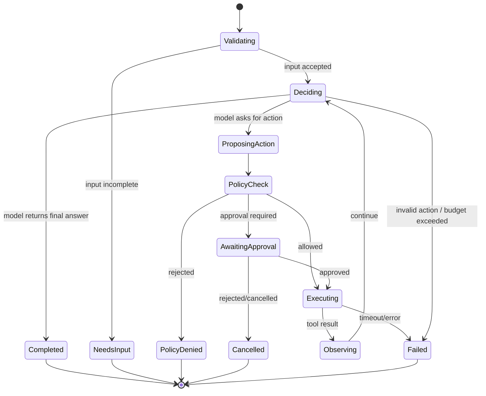

# AR-001：什么是 Agent Runtime，它与 Agent、Workflow 和 Tool 的边界是什么？

> **English summary:** An Agent Runtime is the bounded execution and control
> layer around model-directed work. It owns state transitions, policy-checked
> tool execution, lifecycle limits, traces, and terminal outcomes; it is not
> simply the model, prompt, agent definition, or a framework call.

## 一句话回答 / One-paragraph answer

**Agent Runtime（智能体运行时）** 是把一次 AI 任务从输入推进到可解释终态的执行与
控制层。它接收任务和上下文，维护显式状态，把模型的输出当作“待验证的决策”，在受
策略约束的工具边界内执行动作，记录全过程，并以完成、需要补充、拒绝、失败、取消或
达到预算上限等终态结束。模型提供推理/决策能力，但 Runtime 对实际发生什么负责。

## 为什么重要 / Why it matters

如果把 Agent 等同于“Prompt + LLM + Tool”，企业级问题就会被遗漏：何时停止、是否允许
动作、工具失败如何处理、如何恢复、谁批准、如何追踪和评估。对于拥有平台化和研发效能
背景的工程师，Runtime 正是将模型能力转译为可治理工程系统的核心切入点。

## 边界模型 / Boundary model

| 对象 | 主要职责 | 不应承担的职责 |
| --- | --- | --- |
| Application（应用层） | 用户体验、业务入口、展示结果 | 直接编排每一步模型/工具执行 |
| Agent（智能体定义） | 目标、指令、可用工具、决策偏好 | 进程生命周期、全局安全和持久化策略 |
| Workflow（工作流） | 由代码预先决定的步骤和分支 | 在每个步骤动态决定下一项工作 |
| Agent Runtime（运行时） | 状态、执行循环、策略、限制、Trace、终态 | 具体业务工具本身或单一模型厂商实现 |
| Model adapter（模型适配器） | 将 Runtime 请求转换为模型请求和结构化决策 | 授权工具、定义业务策略 |
| Tool（工具） | 执行受限的外部能力并返回结构化结果 | 自行绕过策略或修改 Runtime 状态 |

**关键区分：**Workflow 的控制路径主要由代码预先指定；Agent 的下一步和工具使用主要由
模型动态选择。两者都需要 Runtime 来执行、限制、追踪和恢复。先构建单 Agent Runtime，
比过早进入多 Agent 编排更容易验证边界。

## 最小状态机 / Minimal state machine



这是 MVP 的**概念状态机**，不是特定框架 API。实现时每条转换都必须产生 Trace 事件和
明确的 stop reason（停止原因）。

## Runtime 的最小契约 / Minimal contract

```text
run(task, context, config) -> {
  status,          // completed | needs_input | policy_denied | failed | cancelled
  output,          // only when a final user-facing result exists
  stopReason,      // explicit, machine-readable reason
  traceId,         // locates the full lifecycle
  stateSnapshot    // safe, resumable state when applicable
}
```

`config` 至少包含：最大步骤/回合数、超时或成本预算、取消信号、工具策略、模型适配器、
Trace sink。Runtime 必须在调用工具前验证名称、参数与授权，而不是相信模型输出。

## 事件与观测基线 / Trace baseline

第一版 Runtime Lab 至少记录以下事件，并将同一次运行关联到一个 `traceId`：

```text
run.started → input.validated → model.requested → model.responded
→ action.proposed → policy.decided → tool.started → tool.finished
→ run.completed | run.failed | run.cancelled
```

事件中应保存最小必要信息；默认不记录原始个人数据、凭证或未脱敏业务内容。Trace 的
内容边界遵循 [信息分级模型](../../docs/architecture/information-boundaries.md)。

## 设计推论 / Design implications

1. **模型输出是提议，不是命令。** 每个工具调用先经过 schema、策略、预算和（必要时）人工批准。
2. **状态必须优先于对话历史。** 对话消息只是状态的一部分；运行进度、工具结果、预算和终态同样需要显式表示。
3. **终态是产品契约。** `needs_input`、`policy_denied` 和 `failed` 不应都被压成普通文本错误。
4. **先可复现，再接真实模型。** MVP 使用 deterministic fake model/tool，以便验证循环与失败路径。
5. **复杂度按证据增加。** 当代码可预先决定路径时优先 Workflow；只有确实需要模型动态选择时才增加 Agent 自主性。

## 与 Runtime Lab 的映射 / Lab mapping

| 本卡结论 | MVP 工程证据 |
| --- | --- |
| 显式状态和终态 | `AR-E02`、`AR-E07`、`AR-E08` |
| 工具策略边界 | `AR-E05`、`AR-E06` |
| 工具失败可诊断 | `AR-E04` 和 Trace ID |
| 结果必须有依据 | `AR-E01`、`AR-E03`、`AR-E10` |

相关资产：[实验设计](../../projects/agent-runtime-lab/experiment.md)、
[评估案例](../../projects/agent-runtime-lab/evals/cases.md)、
[内容简报](../../content/agent-runtime-lab/README.md)。

## 证据与来源 / Evidence and sources

- [OpenAI Agents SDK — Running agents](https://openai.github.io/openai-agents-js/guides/running-agents/)，访问于 2026-07-19：运行状态、回合上限、取消、会话、Tracing 和工具执行配置。
- [OpenAI Agents SDK — Guardrails](https://openai.github.io/openai-agents-js/guides/guardrails/)，访问于 2026-07-19：输入、输出与工具调用前后的检查边界。
- [LangGraph reference](https://langchain-ai.github.io/langgraph/reference/)，访问于 2026-07-19：长运行、有状态 Agent 的编排、持久化和人工介入能力。
- [Anthropic — Building effective agents](https://www.anthropic.com/engineering/building-effective-agents)，访问于 2026-07-19：Workflow 与 Agent 的架构区分，以及“从最简单方案开始”的复杂度原则。

本卡的状态机和最小契约是对上述一手资料的**框架无关工程抽象**，尚需由
`AR-EXP-001` 的确定性实验验证。

## 边界与待验证问题 / Boundaries and open questions

- 本卡不定义长时任务的持久化、断点恢复和分布式调度；这些属于后续 Runtime 能力。
- 工具的授权模型、审计留存、成本记账和租户隔离将在企业化阶段拆成独立知识卡。
- “模型何时应继续而非结束”需要在评估集上验证，不能只靠提示词直觉。

## 产品化假设 / Productization hypothesis

这套 Runtime 边界可沉淀为企业 Agent Runtime Checklist、平台参考架构、工程师工作坊和
评估模板。验证信号是：其他资深工程师能用它解释并诊断一个工具型 Agent 的失败路径。
